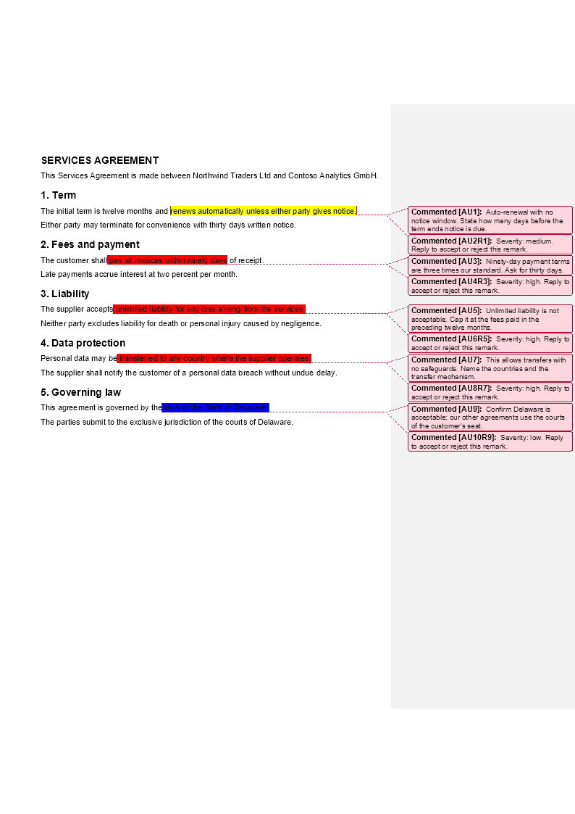

# AI review comments, written into the document

[](https://github.com/groupdocs-annotation/ai-document-review-annotations-net/actions/workflows/build.yml)
[](https://www.nuget.org/packages/GroupDocs.Annotation/)
[](https://dotnet.microsoft.com/)
[](LICENSE)

A model reads a contract and reports back `{quote, comment, severity}`. This sample turns that
answer into **real annotations inside the file** — a highlight on the sentence the model quoted,
the remark as its comment, and a reply thread a human can answer in Word or in Acrobat.

No Word add-in and no browser extension: it is a console application that calls
[GroupDocs.Annotation for .NET](https://products.groupdocs.com/annotation/net/), so the same code
path works on **PDF, DOCX, XLSX and PPTX**, server side, on Windows and Linux.

```
dotnet run --project src/AiReview -- review samples/service-agreement.docx
```



## Read this with

| Resource | What it adds |
|---|---|
| [Blog: Let an LLM review a contract and leave real comments in PDF and Word](https://blog.groupdocs.com/annotation/ai-review-comments-pdf-word-csharp/) | why document-native review beats a chat log, and what the output looks like |
| [Docs: Write AI review comments into documents](https://docs.groupdocs.com/annotation/net/write-ai-review-comments/) | the API reference walk-through, step by step |
| [This repository](https://github.com/groupdocs-annotation/ai-document-review-annotations-net) | the code that runs |

## Quick start

Requires the [.NET SDK 8.0 or later](https://dotnet.microsoft.com/download).

```bash
git clone https://github.com/groupdocs-annotation/ai-document-review-annotations-net.git
cd ai-document-review-annotations-net

# 1. Write the findings from samples/findings.json into the document
dotnet run --project src/AiReview -- review samples/service-agreement.docx

# 2. Read them back out
dotnet run --project src/AiReview -- list output/service-agreement.reviewed.docx

# 3. Remove everything the AI wrote, keep the human markup
dotnet run --project src/AiReview -- revert output/service-agreement.reviewed.docx
```

Open `output/service-agreement.reviewed.docx` in Word: five highlighted phrases, five comments in
the margin, each with a reply waiting for an answer.

### Letting a model produce the findings

`samples/findings.json` stands in for the model so the sample runs offline. To use a real one:

```bash
export ANTHROPIC_API_KEY=...        # setx on Windows
dotnet run --project src/AiReview -- llm-review samples/service-agreement.docx
```

The prompt is in [`prompts/review-prompt.md`](prompts/review-prompt.md) and the call is about forty
lines in [`ClaudeReviewer.cs`](src/AiReview/ClaudeReviewer.cs). Any model that can return JSON works —
the library never sees the model, only the findings.

## Commands

| Command | What it does |
|---|---|
| `review <document> [--findings file] [--out file] [--author name]` | writes findings from a JSON file into the document |
| `llm-review <document> [--model id] [--prompt file]` | asks a model for the findings first (needs `ANTHROPIC_API_KEY`) |
| `list <document>` | prints annotations, authors and replies |
| `revert <document> [--author name]` | removes every annotation by that author |

`review` exits with `2` when a quote could not be found on any page, and names it. Nothing is
placed at a guess.

## How it works

Four steps, and the middle two are where the detail lives.

**1. Read the page text with its geometry.** `GetDocumentInfo()` returns every page with its size
and its text lines, each with a box. The same call answers for PDF, Word, Excel and PowerPoint.

```csharp
IDocumentInfo info = annotator.Document.GetDocumentInfo();
foreach (PageInfo page in info.PagesInfo)
    foreach (TextLineInfo line in page.TextLines)
        Console.WriteLine($"{line.Text} @ {line.LeftIndent},{line.TopIndent}");
```

**2. Match the quote to lines.** A model quotes the sentence it read; the page wraps that sentence
across lines. [`QuoteLocator`](src/AiReview/QuoteLocator.cs) first looks for a single line that
contains the quote, then for a run of consecutive lines whose joined text contains it, and returns
one rectangle per covered line. A quote it cannot find is reported, not guessed.

**3. Convert the coordinates.** Two conventions meet here, and mixing them is the usual reason
markup lands in the wrong place:

| | Origin | Page numbering |
|---|---|---|
| `PageInfo` / `TextLineInfo` | top-left | `PageNumber` is **1-based** |
| `AreaAnnotation.Box` | top-left | — |
| `HighlightAnnotation.Points` and other text markup | **bottom-left** | `PageNumber` is **0-based** |
| `PreviewOptions.PageNumbers` | — | **1-based** |

So a line at `TopIndent = t` with height `h` becomes `pageHeight - t - h` … `pageHeight - t`, and
the page index is `PageInfo.PageNumber - 1`. An annotation addressed to a page that does not exist
is dropped silently — no exception, no markup.

**4. Write the annotation.** Four points per rectangle: top-left, top-right, bottom-left,
bottom-right.

```csharp
annotator.Add(new HighlightAnnotation
{
    PageNumber = page.PageNumber - 1,
    BackgroundColor = 0xFFE699,
    Opacity = 0.5,
    Message = finding.Comment,
    User = new User { Id = 1, Name = "AI reviewer", Role = Role.Editor },
    Points = points,
    Replies = new List<Reply> { new Reply { Comment = "Severity: high. Reply to accept or reject.", RepliedOn = DateTime.Now } }
});
annotator.Save(outputPath);
```

Because every remark carries `User.Name`, the whole review can be withdrawn later without touching
anything a person wrote:

```csharp
annotator.Remove(annotator.Get().Where(a => a.User?.Name == "AI reviewer").ToList());
```

## Layout

```
src/AiReview/
  Program.cs          command line
  DocumentText.cs     pages, lines and their boxes
  QuoteLocator.cs     quote -> rectangles, including wrapped lines
  ReviewWriter.cs     rectangles -> annotations (the coordinate rules live here)
  ClaudeReviewer.cs   optional: ask a model for the findings
  Finding.cs          {quote, comment, severity}
prompts/review-prompt.md
samples/service-agreement.docx, findings.json
```

## Notes

* **Colours.** PDF keeps the exact `0xRRGGBB` value. Word has a fixed palette of highlight colours
  and snaps to the nearest one, so severities look more saturated there.
* **Licence.** Without one the library runs in evaluation mode and the output carries evaluation
  marks. Point `GROUPDOCS_ANNOTATION_LICENSE` at a `.lic` file to remove them
  ([temporary licence](https://purchase.groupdocs.com/temporary-license)).
* **Formats.** The sample ships a `.docx`; pass a `.pdf`, `.xlsx` or `.pptx` and nothing in the code
  changes.

## Related samples

* [annotate-pdf-csharp-net](https://github.com/groupdocs-annotation/annotate-pdf-csharp-net) — the
  starting point: highlight, comment, reply and extract, in one file
* [browser-annotation-ui-net](https://github.com/groupdocs-annotation/browser-annotation-ui-net) —
  the same annotations drawn and answered in a browser
* [GroupDocs.Annotation-for-.NET](https://github.com/groupdocs-annotation/GroupDocs.Annotation-for-.NET) —
  the full example set

## License

MIT, see [LICENSE](LICENSE). GroupDocs.Annotation itself is a commercial library with its own
[licence terms](https://purchase.groupdocs.com/policies/).
